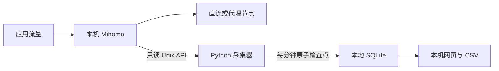

# 架构与统计口径



参考：[Mihomo API](https://wiki.metacubex.one/api/)、`v1.19.31` 的[连接快照实现](https://github.com/MetaCubeX/mihomo/blob/v1.19.31/hub/route/connections.go)与[连接计数器](https://github.com/MetaCubeX/mihomo/blob/v1.19.31/tunnel/statistic/tracker.go)。WebSocket 也定期发送快照，不是保证送达连接最终计数的关闭事件。

## 增量计数

每秒读取 `/connections`。`uploadTotal` / `downloadTotal` 是内核总计数，每条连接有独立 `id`、`upload`、`download`、`start`，以及 `metadata`、`chains`。

已有连接使用“当前累计减去上次累计”，避免重复累加生命周期字节。首次启动或内核重启后的第一个有效快照只建立基线。

新出现且开始时间不早于上次快照的连接，计入当前累计；第一次看到的旧连接只建立基线，避免容量溢出、恢复或快照竞争时重放旧字节。这种保守处理可能减少细分覆盖率。

每份增量分别计入域名、节点、进程、路径四个平行视图，它们不能相加。节点使用 `chains` 第一项；域名依次取 `host`、`sniffHost`、`destinationIP`，缺失时记为“未知”。

## 差额与覆盖率

两次快照之间已结束的连接、最后一次采样之后的尾部字节和采样间隙，可能缺失域名细分，但仍出现在总计数器中。

```text
未归属差额 = max(0, 总量 - 已归属量)
覆盖率 = min(100%, 已归属量 / 总量)
```

总计数和各连接计数并非严格同一时刻读取，边界处可能暂时出现已归属量略大于总量，页面会注明。差额无法可靠区分域名和路径，因此不会强行归给某个代理节点。

## 覆盖范围

- 只统计经过这个 Mihomo 实例的连接。
- DIRECT 是经过 Clash 再由其直连，不包括完全绕过 Clash 的系统流量。
- 计数不等于网卡字节或服务商账单。
- 不解密 TLS，不能按完整 URL、接口、聊天或 HTTP 状态码分类。
- 进程信息取决于内核填充；有字段不代表有值。
- 不将共享 CDN IP 自动归到某个熟悉的域名。

## 恢复和时间

统计采用 UTC+8，采样增量记入采样结束所在日和小时。跨午夜、暂停或休眠后，无法从累计计数器还原字节发生的精确时间。

聚合、最后总计数器和活动连接基线在同一事务提交。正常重启恢复这些基线，避免重复计数。异常退出最多丢失尚未提交的细分观察；内核计数仍连续时，后续可恢复相应总量。

socket 身份变化或计数器回退被视为内核重启，此时建立新基线并记录间隙。仅靠这些信号不能识别所有极端状态变化。

超过 3.5 秒的成功采样间隔记为间隙，保留最近 32 条。跨天间隙的恢复总量记入恢复日，不能据此做精确逐日账单。

## 存储限制

SQLite 使用每日聚合 `daily`、小时总量 `hourly`、检查点 `metadata`、活动基线 `active` 四张表。

| 项目 | 默认限制 |
| --- | ---: |
| 每日聚合 | 35 天，含今天 |
| 小时总量 | 7 天 |
| 每日域名细分项 | 2,000 |
| 每日节点细分项 | 64 |
| 每日进程细分项 | 128 |
| 每日路径细分项 | 4 |
| 活动连接基线 | 8,192 |
| 单次 API 响应 | 4 MiB |
| SQLite 最大页数 | 12,288 × 4 KiB = 48 MiB |
| 日志 | 1 MiB + 1 个轮转备份 |

每日细分上限包含不同路径的键。达到上限后，已有键继续累计，新键按路径归入 `__other__`，避免提前删除一个月内的数据。

SQLite 使用 DELETE 回滚日志，无常驻 WAL。48 MiB 数据库加同量级最坏回滚日志、轮转日志和少量文件，设计预算低于 128 MiB。这不是操作系统磁盘配额；用户额外放入的文件不受限制。

不会预分配全部空间。清理旧分区后 SQLite 复用空闲页，不要求文件立刻缩小，也不定期运行可能增加空间峰值的 VACUUM。

## 展示接口

仅监听 `127.0.0.1:18797`，提供只读 GET：`/`、`/app.js`、`/style.css`、`/api/report`、`/export.csv`。

参数：`period=today|yesterday|7d|30d|35d`，`kind=domain|node|process|route`，`route=all|proxy|direct|blocked|unknown`。API 也接受 `from=YYYY-MM-DD&to=YYYY-MM-DD`。

API/CSV 最多返回前 2,000 个聚合键；网页展示前 100 个。`matched_totals` 保留全筛选范围的总量，避免截断排行后占比失真。
